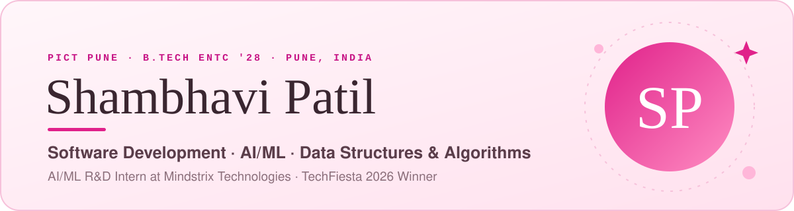

  

 

## 01 / PROFILE

- **Education:** B.Tech in Electronics & Telecommunication Engineering, PICT Pune (2024 – 2028) · CGPA 8.6
- **Experience:** AI/ML Research & Development Intern, Mindstrix Technologies LLP (Mar 2026 – present)
- **Focus:** Software development · AI/ML · Data structures & algorithms
- **Based in:** Pune, Maharashtra, India

## 02 / ABOUT

I'm a third-year Electronics and Telecommunication Engineering student at PICT, Pune. My degree is in ENTC, but most of my time goes into software and AI: projects, hackathons, research and an internship on live AI/ML systems.

My work spans AI for agriculture, Android banking-fraud analysis, satellite remote sensing, reinforcement learning and multi-agent systems. I like taking an idea from a problem statement to a working prototype, testing it against real constraints and improving it from feedback.

> **BUILD · EXPERIMENT · DEBUG · IMPROVE**
>
> I learn by building, breaking, debugging and improving real systems.

 

## 03 / AT A GLANCE

<table>
  <tr>
    <td align="center" valign="top" width="25%"><h3>1st of 600+</h3>teams at TechFiesta 2026</td>
    <td align="center" valign="top" width="25%"><h3>₹15 lakh</h3>government grant, Pune Agri International Hackathon</td>
    <td align="center" valign="top" width="25%"><h3>175+</h3>LeetCode problems solved in C++ and SQL</td>
    <td align="center" valign="top" width="25%"><h3>7</h3>hackathons, from agritech to fintech</td>
  </tr>
</table>

## 04 / SELECTED WORK

<table>
  <tr>
    <td width="50%" valign="top">
      <h3><a href="https://github.com/Shambhavi500/KrishiSahAI">KrishiSahAI</a></h3>
      <b>WINNER · TECHFIESTA 2026</b>
      
AI farm advisory platform that gives Indian farmers crop recommendations and soil analysis.

      <code>Python</code> <code>AI/ML</code> <code>Firebase</code>
    </td>
    <td width="50%" valign="top">
      <h3><a href="https://github.com/Shambhavi500/KRISHI-PRABANDH">KRISHI-PRABANDH</a></h3>
      <b>RUNNER-UP · PUNE AGRI INTERNATIONAL HACKATHON</b>
      
Agricultural governance platform that verifies land records with OCR and satellite NDVI to speed up subsidy processing.

      <code>React</code> <code>FastAPI</code> <code>OCR</code> <code>NDVI</code>
    </td>
  </tr>
  <tr>
    <td width="50%" valign="top">
      <h3><a href="https://github.com/Shambhavi500/Sudarshan">Sudarshan</a></h3>
      <b>ANDROID SECURITY</b>
      
Finds fake banking apps, takes them apart in a Frida sandbox and tells the bank exactly what to do next.

      <code>Python</code> <code>Frida</code> <code>FastAPI</code> <code>React</code>
    </td>
    <td width="50%" valign="top">
      <h3><a href="https://github.com/Shambhavi500/Pramaan">Pramaan</a></h3>
      <b>CODE CUBICLE 6.0 · CLOUDINARY TRACK</b>
      
Tamper-evident evidence pipeline for field photos, with an explainable trust score for every image.

      <code>Next.js</code> <code>Cloudinary</code> <code>Supabase</code> <code>Gemini</code>
    </td>
  </tr>
  <tr>
    <td width="50%" valign="top">
      <h3><a href="https://github.com/Shambhavi500/Nivasa">Nivasa</a></h3>
      <b>STUDENT HOUSING</b>
      
Hostel and PG finder for Pune students that ranks stays by budget, commute and food on a real OpenStreetMap map.

      <code>React</code> <code>TypeScript</code> <code>FastAPI</code> <code>Leaflet</code>
    </td>
    <td width="50%" valign="top">
      <h3><a href="https://github.com/Shambhavi500/AlphaTrader-RL">AlphaTrader-RL</a></h3>
      <b>META PYTORCH OPENENV CHALLENGE</b>
      
Reinforcement-learning trading environment on NSE stock data, with a 50-dimensional observation space.

      <code>Python</code> <code>Gymnasium</code> <code>Docker</code>
    </td>
  </tr>
  <tr>
    <td width="50%" valign="top">
      <h3><a href="https://github.com/Shambhavi500/Aira">Aira</a></h3>
      <b>FINTECH</b>
      
Revenue recovery system that diagnoses failed payments and runs the right recovery workflow for each case.

      <code>TypeScript</code> <code>Python</code> <code>Gemini</code>
    </td>
    <td width="50%" valign="top">
      <h3><a href="https://github.com/Shambhavi500/Ovio">Ovio</a></h3>
      <b>AGENTIC CINEMA HACKATHON</b>
      
Multi-agent assistant that turns plain-language instructions into DaVinci Resolve timeline edits.

      <code>Python</code> <code>FastAPI</code> <code>Next.js</code> <code>Gemini</code>
    </td>
  </tr>
</table>

<b>More projects</b>

 

| Project | What it is |
|---|---|
| [NDVI_satellite](https://github.com/Shambhavi500/NDVI_satellite) | Crop-health engine on Google Earth Engine that fuses six Sentinel-2 vegetation indices |
| [Bhumi](https://github.com/Shambhavi500/Bhumi) | Explains satellite-flagged crop stress and seals the field evidence on-chain |
| [FieldDX](https://github.com/Shambhavi500/FieldDX) | Differential diagnosis for farm fields from Sentinel-2 imagery |
| [Nova](https://github.com/Shambhavi500/Nova) | Household commerce agent on Amazon Bedrock and MCP, built for AWS Agents for Humans |
| [Smaran](https://github.com/Shambhavi500/Smaran) | Offline-first memory for edge fleets on Qdrant, built for Code Cubicle 6.0 |
| [Kounter](https://github.com/Shambhavi500/Kounter) | Offline shop-audit concept for kirana stores on the iQOO 15, built for the iQOO Hackathon 2026 |
| [Leetcode_Que](https://github.com/Shambhavi500/Leetcode_Que) | My LeetCode solutions, synced automatically and sorted by topic |

## 05 / RECOGNITION

| Result | Event | Project |
|---|---|---|
| **Winner:** 1st of 600+ teams, ₹50,000 prize | TechFiesta 2026, Agriculture domain | [KrishiSahAI](https://github.com/Shambhavi500/KrishiSahAI) |
| **National runner-up:** ₹15 lakh government development grant, presented to senior government officials | Pune Agri International Hackathon 2026 | [KRISHI-PRABANDH](https://github.com/Shambhavi500/KRISHI-PRABANDH) |

**Also built for:** Code Cubicle 6.0 · iQOO Hackathon 2026 · AWS Agents for Humans · Meta PyTorch OpenEnv Challenge · Agentic Cinema (Devpost)

## 06 / EXPERIENCE

**AI/ML Research & Development Intern** · Mindstrix Technologies LLP 
MAR 2026 – PRESENT · PUNE · REMOTE / HYBRID

- Build modules for data processing, model training and system integration on live AI/ML products.
- Prepare test data and run test cases across the software development lifecycle.
- Work in an Agile team through technical reviews and cross-functional planning.

**B.Tech, Electronics & Telecommunication Engineering** · Pune Institute of Computer Technology 
2024 – 2028 · CGPA 8.6 · HSC 89.83% · SSC 96.40%

**Beyond code:** Volunteer with NGO UPAY, teaching digital skills to underprivileged students · Zonal-level chess player

## 07 / TECH STACK

| Area | Tools |
|---|---|
| **Languages** |  |
| **Frameworks** |  |
| **AI / ML** |  Gymnasium · Google Earth Engine · Gemini API · multi-agent systems |
| **Mobile & hardware** |  Embedded C · sensors · Proteus · Tinkercad |
| **Tools & data** |  |

## 08 / GITHUB ACTIVITY

  

<a href="https://github.com/Shambhavi500">
  <picture>
    <source media="(prefers-color-scheme: dark)" srcset="https://streak-stats.demolab.com?user=Shambhavi500&background=0D1117&border=30363D&stroke=E0218A&ring=FF4F9A&fire=FF4F9A&currStreakNum=FFB6D9&sideNums=FFB6D9&currStreakLabel=FF4F9A&sideLabels=C9A9B8&dates=8B949E">
    
  </picture>
</a>

## 09 / PROBLEM SOLVING

175+ LeetCode problems solved, mostly arrays, math and hash tables in C++ and database problems in MySQL. Every accepted submission is pushed to [Leetcode_Que](https://github.com/Shambhavi500/Leetcode_Que) automatically and sorted by topic.

## 10 / STATEMENT

Right now I'm strengthening my software, AI/ML and DSA fundamentals, learning from industry work at Mindstrix, and building projects for real users: farmers, students and the analysts who fight banking fraud.

**Building today for the engineer I want to become.**

## 11 / CONNECT

  

Pune, India

